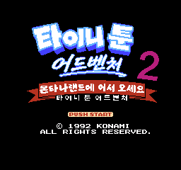

# 타이니 툰 어드벤처스 2 — 패미컴 / NES

패미컴 / NES **타이니 툰 어드벤처스 2** 한글 번역 패치 프로젝트입니다. 몬태나 랜드를 배경으로 한 타이니 툰 시리즈 액션 게임입니다.

> **정식 배포 v1.0**

<!-- game-preview:start -->

  

**한글 타이틀** — title_kr_ai_003_attract Mesen 캡처
<!-- game-preview:end -->

## 다운로드 및 적용 방법

1. 아래 체크섬 또는 상세 안내와 일치하는 원본을 준비합니다.
2. [최종 배포 패치 다운로드](https://github.com/akuma815/nes-tiny-toon-adventures-2-kr-patch/releases/tag/v1.0)에서 ZIP을 받아 모두 압축 해제합니다.
3. 원본 ROM 또는 ISO를 동봉 `apply.cmd`에 끌어다 놓습니다.
4. 생성된 한글판 파일의 SHA-256을 확인하고 실행합니다.

## 주의사항

- 일본판 Montana Land e Youkoso 전용이며 1편 패치와 호환되지 않습니다.
- 데이터 기준은 062입니다. 실제 화면·완주 1차 검수 완료는 사용자의 보고이며 배포 후 추가 검증이 예정되어 있습니다.
- HOWTO·PAUSE·POW 등 원문 유지 항목과 이전 세이브스테이트 호환 미확인을 동봉 안내에서 확인하세요.
- 원본 게임·BIOS 및 패치가 적용된 게임 이미지는 포함하지 않습니다.

## 체크섬

| 구분 | SHA-256 |
| --- | --- |
| 원본 | `f41607b80904a2e1150a155121405dd1fed007ce98ff00a274a7891cafd7e32d` |
| 패치 파일 `TinyToonAdventures2_KR_v1.0_Release_20261009.xdelta` | `ddd29d4b8c12d242356be5b488259fc0feab05a1ae8d66e05e32211f34e48076` |
| 패치 후 이미지 | `7e32acb4ac08d47ec821421d0ebf704fd98225be194e736f9fff7b1b5b5722ce` |
| 배포 압축 파일 | `0e470e45968cb388f296a3103c0004641ede834f14872921d087250d9f0c0aaa` |

## 소스 및 작업 기록

[공개 소스 구성과 빌드 전제](docs/SOURCE_GUIDE.md) · [상세 패치 안내](docs/PATCH_GUIDE.txt)

## 최종 빌드 재현

[원본에서 재현하는 명령과 필수 입력](docs/REBUILD_RELEASE.md)을 확인하세요. 기존 패치의 결과와 같은 SHA를 생성하며, 새 플레이 검수 결과를 뜻하지 않습니다.
